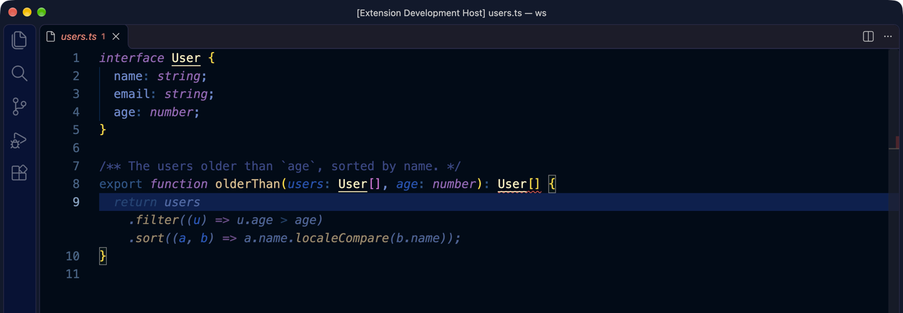
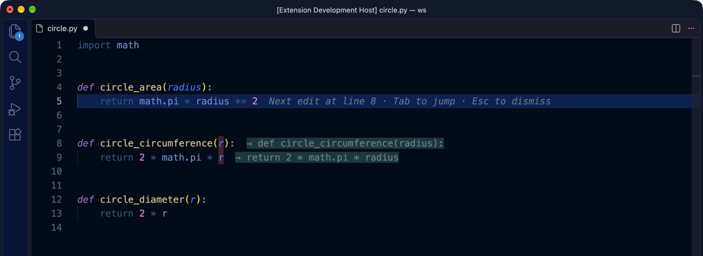
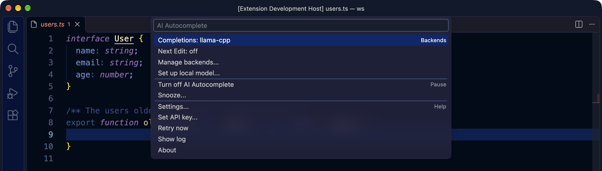
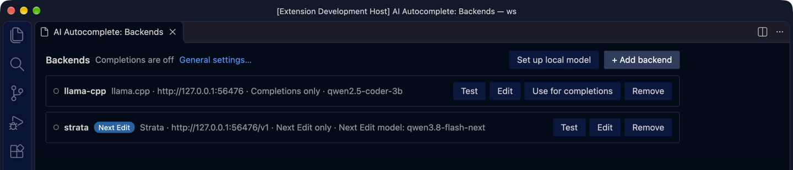

# AI Autocomplete

[](https://github.com/Raboo/vscode-ai-autocomplete/actions/workflows/ci.yml)

Autocomplete only: fast ghost-text code completion for VS Code, with no chat, no agents and no telemetry. It is self-hosted first, working with llama.cpp, LM Studio and vLLM, and it also supports Mistral Codestral, Strata and OpenRouter.

- **Ghost-text completions** as you type, from a fill-in-the-middle model; `Tab` accepts.
- **Next Edit** suggests the change that follows the one you just made, such as a rename carried to the lines below.
- **Local models in one step:** Set Up Local Model downloads a small model and runs it with llama.cpp.
- **Your own server or a hosted API:** llama.cpp, LM Studio, Ollama, vLLM, Mistral Codestral, OpenRouter and other OpenAI-compatible servers.
- **Private by design:** no telemetry, credential files excluded by default, and a local-only switch.

## Quick start

- Run **AI Autocomplete: Set Up Local Model** from the Command Palette and pick a runtime and a model, or
- run **AI Autocomplete: Manage Backends**, press **+ Add backend** and connect a server you already run.

New here? **Get Started with AI Autocomplete** (Command Palette: *Welcome: Open Walkthrough...*) walks through these steps.

Then start typing in a code file and press `Tab` to accept a suggestion.

## How it looks

**Completions:** ghost text at the cursor, accepted with `Tab`.



**Next Edit:** after renaming `r` to `radius` in one function, the extension suggests the same rename further down. `Tab` jumps to it and applies it; `Esc` dismisses it. With VS Code's native inline-edit view enabled, the suggestion shows in that view instead.



**Status bar menu** and the **Backends page:**





## Getting started

### 1. Run a model with llama.cpp

llama.cpp is the example here. The extension also works with LM Studio, Ollama, vLLM, SGLang and other servers with an OpenAI-compatible `/v1/completions` endpoint, and with the hosted Mistral Codestral, DeepSeek, Fireworks and Together APIs.

```sh
brew install llama.cpp
llama-server --fim-qwen-3b-default --port 8012
```

On Linux and Windows, download a build from the [llama.cpp releases](https://github.com/ggml-org/llama.cpp/releases) instead. The `--fim-qwen-3b-default` preset downloads Qwen2.5-Coder 3B the first time it runs.

With llama.cpp on this machine (`localhost` or `127.0.0.1`), the extension warms the server up: when you switch to a file it sends the code around the cursor once (at most every 30 s per file, generating nothing) so llama.cpp has it cached before you type, and after you accept a suggestion it asks for the next one at once and keeps it ready for your next keystroke. Neither shows anything by itself, and neither runs for remote servers.

### 2. Point the extension at it

Run **AI Autocomplete: Manage Backends** from the Command Palette. The status bar menu, the **Connect a Server** button of the first-run notification and the link in the `aiAutocomplete.backends` setting open the same page. The Backends page lists your backends and lets you add one, say what it is used for, pick its models from the server's list, set a key, test the connection and tune its completion settings. Saving a backend from the page rewrites the whole `aiAutocomplete.backends` array in your user settings, so comments inside that array are lost. The test sends built-in samples, never your code.

Or edit the settings by hand. Open your user settings (**Preferences: Open User Settings (JSON)**) and add:

```jsonc
"aiAutocomplete.backends": [
  { "id": "local", "kind": "llamacpp", "baseUrl": "http://127.0.0.1:8012" }
],
"aiAutocomplete.completions.backend": "local"
```

Start typing and suggestions appear as ghost text; press `Tab` to accept one. To ask for a suggestion yourself, press `Alt+\` (`Option+\` on macOS), VS Code's shortcut for **Trigger Inline Suggestion**.

If the server is not running yet, the status bar shows an error and the extension retries on its own after a while. Run **AI Autocomplete: Retry Now** (also in the status bar menu) to retry at once.

Backends go in your user settings only; see [Privacy](#privacy) for why.

Renamed settings: `aiAutocomplete.fim.*` is now `aiAutocomplete.completions.*`, and the backend fields `fimModel`, `fimMode` and `fim` are now `model`, `mode` and `completions`. When it starts, the extension moves old `aiAutocomplete.fim.*` keys in your user settings to the new names (for `disableInFiles` set under both names, the two lists are joined). It never changes workspace or folder settings, and never rewrites `aiAutocomplete.backends`: a backend gets the new field names when you save it from the Backends page. Until 1.0 old names keep working everywhere, with a note in the log (old and new `disableInFiles` lists are joined at each level).

### Local models

**AI Autocomplete: Set Up Local Model** does the steps above for you. It is also in the status bar menu (**Set up local model...**) and on the Backends page (the button next to **+ Add backend**). It works in local windows only, not in a remote window.

It asks for a runtime and a model, and then:

1. downloads the model file with a progress notification (Cancel stops it; running the command again resumes from the partial file);
2. starts the model;
3. adds a backend, selects it for what the model can do (completions, Next Edit or both) and runs the Test from the Backends page;
4. shows the result in a notification. If the Test fails, the backend stays and the notification offers **Open Backends**.

If a step before the Test fails, setup writes no backend, puts your selection settings back and stops the server it started. If the backend already exists, setup asks before it replaces it.

**Runtimes.** Neither one is installed for you. The picker shows how to install one that is missing.

- **llama-server** (from llama.cpp). VS Code starts it on `127.0.0.1` (port 8012, or a free port if that one is taken). It starts when its backend is selected for completions or Next Edit, at VS Code start or when you select it, and stops when you select another backend. All VS Code windows share one server: a window that finds it already running on its port uses it. VS Code stops it when the window that started it closes; other windows take it over. If it stops unexpectedly, a notification says so. The backend id is `local-<model>`, for example `local-sweep-1-5b`.

If a command is not on PATH or in the usual install places, set `aiAutocomplete.local.llamaServerPath` in your user settings. It is machine-scoped: a workspace cannot set it.

**Models.** Each file is a GGUF, pinned to one Hugging Face revision and checked by sha256 after the download. The context size is 8192 for all of them. A model whose file is more than 40% of your memory is marked "may not fit in memory".

| Model | Size | Use | Licence | Model name |
| --- | --- | --- | --- | --- |
| Sweep Next Edit 1.5B (recommended) | 1.5 GB | completions and Next Edit | Apache-2.0 | `sweep-next-edit-1.5b` |
| Qwen2.5-Coder 1.5B | 1.6 GB | completions | Apache-2.0 | `qwen2.5-coder-1.5b` |
| Qwen2.5-Coder 3B | 3.3 GB | completions | Apache-2.0 | `qwen2.5-coder-3b` |
| Qwen2.5-Coder 7B | 8.1 GB | completions | Apache-2.0 | `qwen2.5-coder-7b` |
| Mellum 4B | 4.3 GB | completions | Apache-2.0 | `mellum-4b-base` |

Zeta 2.1 and Sweep v2 7B have no official GGUF, so they are not in the list. Set them up by hand on the Backends page. LM Studio runs these GGUF files on its llama.cpp engine; to use an MLX model, add it by hand too.

**Where files go.** In VS Code's global storage for the extension, under `models/<owner>/<repo>/<file>`. On macOS that is `~/Library/Application Support/Code/User/globalStorage/raboo.ai-autocomplete/models/`. A download that was cancelled leaves a `.part` file there.

**Stopping and removing.**

- **AI Autocomplete: Stop Local Models** stops the llama-server processes now, in all windows. They start again when VS Code starts (or a window opens) with their backends still selected, or when you select their backend again.
- **AI Autocomplete: Remove Downloaded Models** lists the files (partial downloads too, except one this window is downloading) and deletes the ones you tick, after you confirm. It stops any managed server that uses a deleted file. A backend whose file was deleted stops working until you set it up again.

The only request that leaves your machine is the download from `huggingface.co` (which redirects to Hugging Face's file servers). Setup sends nothing else off the machine, and the local backend it adds is on `127.0.0.1`.

### Other backends

**Mistral Codestral:**

```jsonc
"aiAutocomplete.backends": [
  { "id": "codestral", "kind": "mistral", "baseUrl": "https://codestral.mistral.ai", "model": "codestral-latest" }
],
"aiAutocomplete.completions.backend": "codestral"
```

Then run **AI Autocomplete: Set API Key** from the Command Palette, pick `codestral` and paste your key.

**LM Studio or vLLM** (OpenAI-compatible `/v1/completions`):

```jsonc
"aiAutocomplete.backends": [
  { "id": "lmstudio", "kind": "openai", "baseUrl": "http://127.0.0.1:1234/v1", "model": "qwen2.5-coder-3b" }
],
"aiAutocomplete.completions.backend": "lmstudio"
```

Set `model` to the model name the server lists. It must be a coder model with a fill-in-the-middle template: Qwen2.5-Coder, Codestral, DeepSeek-Coder, StarCoder, Code Llama, CodeGemma, Granite, Seed-Coder or Mellum. vLLM listens on port 8000 by default, so its `baseUrl` is usually `http://127.0.0.1:8000/v1`.

The extension recognises LM Studio and Ollama only by their default ports (1234 and 11434). For any other self-hosted server, such as vLLM on port 8000, add `"hostFlavor": "vllm"` (or `"lmstudio"`, `"ollama"`) to the backend. Without it the server is treated as a hosted API: `top_k` is not sent and only the first 4 stop sequences are sent.

```jsonc
{ "id": "vllm", "kind": "openai", "baseUrl": "http://127.0.0.1:8000/v1", "hostFlavor": "vllm", "model": "Qwen/Qwen2.5-Coder-7B" }
```

You can list several backends and switch between them with **AI Autocomplete: Select Completion Backend**.

### Turning it off

Click **AI** in the status bar for the menu:

- **Turn off AI Autocomplete** stops completions and Next Edit together (the `aiAutocomplete.enabled` setting); **Turn on AI Autocomplete** brings back exactly what you had, because both backend choices stay. The status bar shows the off icon meanwhile. **AI Autocomplete: Turn On/Off** in the Command Palette does the same.
- **Completions: <backend>** picks the completion backend, or **Off** (`aiAutocomplete.completions.enabled`); the backend choice stays, and picking a backend turns completions back on. **Next Edit: <backend>** works the same way for Next Edit (`aiAutocomplete.nextEdit.enabled`). With completions off and Next Edit on, the status bar stays normal and its tooltip says "Completions: off".
- **Snooze...** pauses both for 15 minutes, an hour or until VS Code restarts.

### Why no suggestion?

When nothing appears, run **AI Autocomplete: Why No Suggestion?** (also in the status bar menu). It lists the latest completion requests for the active file, newest first, with the reason in plain words (for example "Skipped: the cursor is inside a word") and how long ago. The status bar tooltip also shows this session's request, shown and accepted counts and the median latency. These records and counts stay in memory, hold no code or prompt text, are gone when the window closes and are never sent anywhere.

### What a backend is used for

Each backend has **Use for** checkboxes on the Backends page: **Completions**, **Next Edit** or both. A backend with only Next Edit ticked is never used for ghost-text completions, so you can add a Zeta server and keep it out of the completion picker. A Sweep model can do both: it is a Qwen2.5-Coder fine-tune and fills in the middle with the qwen template, so one Sweep backend with both boxes ticked serves completions and Next Edit.

- **Model** shows only with Completions ticked, and **Next Edit model** only with Next Edit ticked. With both ticked, an empty Next Edit model means the same model as for completions. With only Next Edit ticked, an empty Next Edit model means the model the server lists (or the one you pick from its list). The Next Edit model's hint says which format the model will use: "Zeta 2.1 format", "Sweep v1 format", "Sweep v2 format" or "chat prompt (chatXtab)".
- At least one use must stay ticked. Unticking a use removes that use's model when you save.
- Each backend's card says what it is used for ("Completions · Next Edit", "Completions only" or "Next Edit only") and has **Use for completions** and **Use for Next Edit** buttons, with a "Completions" or "Next Edit" badge on the backend selected for it.
- **Select Completion Backend** (the menu's **Completions** entry) lists only backends used for completions. **Select Next Edit Backend** lists only backends used for Next Edit (and Off). **Set API Key** lists all backends.
- **Test connection** runs one check per ticked use: the completion steps with Completions ticked, and then a Next Edit step with Next Edit ticked. A backend with both uses gets the Next Edit step only when it has a Next Edit model or is the backend selected for Next Edit, so a completions-only setup that predates `use` tests as before; a Next Edit-only backend always gets it. The Next Edit step sends a built-in sample edit (a renamed variable) through the same format and request code the editor uses, and passes when the model suggests an edit. It shows a warning when the model answered but suggested no edit, or when the answer was cut at its token limit, and a failure when the answer could not be read or the model keeps thinking.

In the settings file the field is `use`, a list of `"completions"` and `"nextEdit"`:

```jsonc
{ "id": "zeta", "kind": "openai", "baseUrl": "http://127.0.0.1:1234/v1", "nextEditModel": "zeta-2.1", "use": ["nextEdit"] }
```

A backend with no `use` is used for both, as before, so existing settings need no change. An unknown value in the list is reported as a problem and ignored; an empty list, a list with only unknown values or a value that is not a list is reported as a problem and counts as both. If `aiAutocomplete.completions.backend` is unset, the first backend used for completions is selected. If it names a backend that is not used for completions, completions have no backend until you change it, and the log says so. `aiAutocomplete.nextEdit.backend` likewise needs a backend used for Next Edit. On a Next Edit-only backend the completion model is never used for Next Edit.

### Per-backend settings

Each backend can carry a `completions` object with its own completion settings. The Backends page edits the same fields.

```jsonc
{ "id": "local", "kind": "llamacpp", "baseUrl": "http://127.0.0.1:8012",
  "completions": { "contextTokens": 8000, "temperature": 0.1, "multiline": "auto" } }
```

Fields: `template`, `contextTokens` (default 4700), `prefixLines` (lines before the cursor; the window starts on a multiple of a quarter of this value so the prompt start stays stable (unless the `contextTokens` budget cuts it), so it can hold up to `prefixLines + step − 1` lines, with `step` being `prefixLines / 4` rounded down and at least 1), `suffixLines`, `extraContext` (can only switch it off), `multiline`, `maxTokens`, `temperature`, `topP`, `topK`, `debounceMs`, `timeoutMs`, `stop`, `extraBody`, `thinking`. A backend can also set `mode` and `headers` at the top level.

A value is taken from the first of these that sets it: the backend's `completions` object, a matching `aiAutocomplete.modelOverrides` entry, the general `aiAutocomplete.completions.*` settings, then the built-in preset for the model. Three fields work differently: the backend's `stop` sequences are added to the preset's and the override's, not used instead of them; its `extraBody` is merged over the override's; and its `extraContext` can only switch extra context off: it cannot turn it on while `aiAutocomplete.completions.extraContext` is off.

### Keep requests on your machine

```jsonc
"aiAutocomplete.privacy.localOnly": true
```

With this on, requests go only to backends on loopback or private-network addresses. Anything else is blocked and the status bar shows an error.

### Chat models (Strata, OpenRouter, general instruct models)

A model with no fill-in-the-middle support, such as a general instruct or chat-only model, completes through a chat prompt. It is slower than FIM. Chat models must be able to turn thinking off: autocomplete waits 5 s for an answer, and a model that reasons first cannot give one. With `mode` on `auto`, a chat model uses the chat prompt automatically, and so does a server that has no raw completions endpoint. Set the prompt mode to `chat` on the Backends page to force it.

Thinking is turned off per model family and server. The Thinking dropdown on the Backends page (the `thinking` field of the backend's `completions` object) overrides what the extension picks. Reasoning text is never shown.

A model that cannot turn thinking off (gpt-oss, DeepSeek R1 and similar, or an OpenRouter model that must reason) is not used: the model list tags it `chat prompt, cannot turn thinking off`, the Test fails, and the status bar shows `cannot turn thinking off`. A model that keeps thinking although thinking was asked off fails the same way, and the status bar shows `keeps thinking`. For a model that keeps thinking, **Retry now**, a passing Test or a changed API key lets the extension try it again; a settings change clears everything it learned.

When a model keeps thinking, **Test connection** tries the other thinking switches on a sample and suggests one that works ("choose ... as the Thinking switch"). On Strata, DeepSeek, Ollama and OpenRouter the server decides how thinking is turned off, so only the `/no_think` switch is tried.

Every request has a 5 s deadline. Set the backend's Timeout (`timeoutMs`) to change it.

With the cursor after only indentation, a chat model often types the indentation again; the extension drops it when the rest of the answer lines up with it.

**Strata** serves chat only. Strata's default address is `http://127.0.0.1:8080/v1`:

```jsonc
{ "id": "strata", "kind": "openai", "hostFlavor": "strata", "baseUrl": "http://127.0.0.1:8080/v1" }
```

On Strata the extension pins the unchanged start of the prompt so Strata can reuse its cache between keystrokes. Measured on a test Strata server (Qwen3.8, 2026-11-15), a 1750-token prompt took 3.6 s without the pin and 0.9 s with it (1691 tokens reused). The first request of a file still reads the whole prompt (about 4 s there), so on a large file the first suggestion can miss the 5 s deadline: raise the backend's Timeout on the Backends page.

**OpenRouter:** run **AI Autocomplete: Set API Key** and paste your key. Without a key no code is sent (the model list still loads; it needs no key). A model that must reason on OpenRouter is noticed on its first request (the server rejects turning reasoning off) and then treated like one that cannot turn thinking off. OpenRouter completes through the chat prompt only, because a raw FIM prompt reaches the model only with some of the providers OpenRouter picks. An "Other OpenAI-compatible" backend pointed at `openrouter.ai` follows the same rules.

```jsonc
{ "id": "openrouter", "kind": "openai", "hostFlavor": "openrouter", "baseUrl": "https://openrouter.ai/api/v1", "model": "z-ai/glm-5" }
```

**LM Studio:** when the status bar says the model keeps thinking, turn thinking off in LM Studio; the extension cannot switch it per request there. For a model from LM Studio's catalog, switch off **Enable Thinking** in its settings. For a model downloaded from Hugging Face, add `` as the first line of its prompt template (My Models → the model's settings → Prompt Template).

**LM Studio's MLX engine** drops the leading space of the first text a model sends on raw completions (mlx-lm's detokenizer), so `return` + ` a + b` would arrive as `returna + b`. The extension works around it on LM Studio backends: with text on the cursor's line, the request leaves out the line's last character and the model writes it again first (the extension removes it), and at the start of a line an answer that still starts with a space gets the lost one back. If the model does not repeat that character, there is no suggestion (the debug log says so). Next Edit with Sweep repairs its first line itself. The line-start rule is used only for models LM Studio reports as MLX, since its llama.cpp engine (GGUF models) may not drop the space. LM Studio also fails a completion that reaches its token limit just after a line break when asked to stop at blank lines, so the extension applies such stop strings itself instead of sending them.

**Other autocomplete extensions** (for example Predicte, Kilo Code or Continue) can show their own ghost text or take the `Tab` key, so `Tab` may indent or insert their suggestion instead. Turn their autocomplete off while you use this one.

## Next Edit

Next Edit suggests the edit you are likely to make next. After you change code, for example rename a parameter, the extension asks a model to rewrite a small region around the cursor (by default 5 lines above, 10 below) and shows the result. It is off until you choose a backend, so completion-only users send no extra requests.

**Turn it on:** run **AI Autocomplete: Select Next Edit Backend** and pick a backend; only backends with **Next Edit** ticked under **Use for** are listed. To use a different model than the completions, set **Next Edit model** on the Backends page (`nextEditModel`); with both uses ticked and no Next Edit model, the backend's completion model is used. On a backend with only Next Edit ticked there is no completion model: the Next Edit model, or the model the server lists, is used. Press **Test connection** on the backend to check that its Next Edit model answers in its format. When the server lists several models, set `nextEditModel`, so the extension does not have to guess which one to use. A Next Edit backend, like a completion backend, can be picked per workspace only from the backends in your user settings. **Off** in the same picker (the menu's **Next Edit** entry) turns it off again. **Snooze...** and **Turn off AI Autocomplete** pause Next Edit too; **Off** under **Completions** turns off completions only.

**Typing it yourself:** if you start typing what Next Edit suggests (or what it is about to suggest), the rest of the suggestion stays and moves with your text; `Tab` applies what is left. Any other change drops it.

**Formats:** `aiAutocomplete.nextEdit.format` (default `auto`) picks the prompt and answer format. In `auto` the model's name decides: a name with `zeta` gets Zeta 2.1, a name with `sweep` gets Sweep, any other model gets `chatXtab`.

| Format | Fits | Route |
| --- | --- | --- |
| `sweep` | Sweep next-edit 0.5B, 1.5B and v2-7B | raw completions (llama.cpp `/completion`, or `/v1/completions` on LM Studio and others) |
| `zeta21` | Zeta 2.1 | raw completions |
| `chatXtab` | chat models such as Qwen3.8 on Strata | chat |

Sweep 0.5B and 1.5B use Sweep's first prompt layout; a model name with `v2` or `7b` uses the v2 layout. Which layout the 0.5B and 1.5B GGUF files answer best is not settled yet. To force v2, set the format to `sweep` and use a model name that contains `v2`.

Sweep and Zeta need a server with a raw completions route, so they do not work on Strata. The format setting is global, and `auto` reads the Next Edit model's name: if you run a Zeta model next to a completion model, name the Zeta model in the backend's `nextEditModel`. Sweep always uses its trained window of 10 lines above and below the cursor; the region settings below do not change it.

A file that contains one of a format's special strings (for example `<|file_sep|>` for Sweep, `<|marker_1|>` or `<[fim-suffix]>` for Zeta) gets no Next Edit request in that format, because the model would read the text as control tokens. This repo's own sources are such files. The log says why nothing was asked.

**What shows without the opt-in:** an edit that is a pure insertion at the cursor shows as ghost text. Any other edit (a change on another line, a replacement) shows as decorations: the old text that changes gets a red background, the new text of each line shows after it, extra new lines are counted as "(+N lines)", and a hint on the cursor line says what `Tab` does.

**Display:** `aiAutocomplete.nextEdit.display` (default `auto`) chooses between the two views for edits that are not ghost text. `auto` uses the native view when the opt-in is active and decorations otherwise. `native` shows inline edits only with the opt-in (nothing otherwise, with the one-time notice). `decorations` always uses decorations. The native view is the better one: it draws the diff the way VS Code draws its own suggestions. Decorations work in any VS Code with no setup.

With a decoration showing:

- `Tab` moves the cursor to the edit when it is away from the cursor line; a second `Tab` applies it. When the edit is at or next to the cursor line, one `Tab` applies it.
- `Esc` dismisses it, and nothing shows again for 5 s.
- `Tab` keeps its normal job when something else wants it: accepting ghost text, a native inline edit or a suggest-widget item, moving through snippet placeholders, and indenting a selection or multiple cursors. `Esc` keeps its normal job with multiple cursors, ghost text, the suggest widget or snippet mode.
- Any change to the file, a switch to another editor, snooze or a new result clears the decoration. `Tab` never applies an edit to text that changed.

**Native inline edits:** run **AI Autocomplete: Enable Native Next Edit UI**, then quit and reopen VS Code (not just reload the window). The command adds this extension to `enable-proposed-api` in VS Code's `argv.json`. It keeps the comments in that file; if the file is malformed it is left alone and VS Code's runtime-arguments file opens with instructions to paste. Until you opt in, VS Code logs an error that the extension declares a proposed API it may not use. That is expected.

With the opt-in (and `display` on `auto` or `native`), an edit away from the cursor shows as an inline edit. `Tab` jumps to it and `Tab` again accepts it. `Esc` dismisses it, and nothing shows again for 5 s. After you accept, the next suggestion is requested at once, so repeated `Tab` walks through a refactor.

**When it asks:** 400 ms after you stop typing, when completions had nothing to show for that version of the file; and when you move the cursor within 10 s of an edit (not twice on the same line within 5 s). Completions win while you type. With VS Code's default `editor.quickSuggestions`, the word suggestion list can take the request that follows typing; Next Edit then asks on your next cursor move. It does not ask when the region holds a line starting with ```` ``` ```` (a Markdown code block) or is very long (minified code). Files that completions may not use (`aiAutocomplete.completions.disableInFiles`, `completions.disableInLanguages`, files outside the workspace) never get a Next Edit request.

**What is sent:** the 10-line pages of the current file around the region, the region itself with the cursor marked, and the current file's recent edits as diffs. Those diffs always go to the Next Edit backend. Snippets and diffs of your other files go only while `aiAutocomplete.completions.extraContext` is on.

**Settings:**

| Setting | Default | Limits |
| --- | --- | --- |
| `aiAutocomplete.nextEdit.format` | `auto` | `auto`, `chatXtab`, `sweep`, `zeta21` |
| `aiAutocomplete.nextEdit.display` | `auto` | `auto`, `native`, `decorations` |
| `aiAutocomplete.nextEdit.regionLinesAbove` | 5 | 0 to 20 |
| `aiAutocomplete.nextEdit.regionLinesBelow` | 10 | 0 to 40 |
| `aiAutocomplete.nextEdit.historySize` | 5 | 0 to 10 recent edit diffs |
| `aiAutocomplete.nextEdit.contextBudget` | 3500 | 1000 to 16000 tokens, split between the file (3/7), the edit history (2/7) and recently viewed snippets (2/7) |

A value outside its limits is ignored, and a warning names it. The region settings apply to `chatXtab` and `zeta21`, not to Sweep.

**Status bar menu:** besides **Next Edit: <backend>**, the menu has **Enable native Next Edit UI...**, which appears until the native view is active (it runs the opt-in command above; after a successful opt-in it stays until VS Code restarts). **Settings...** opens the Settings page filtered to this extension.

**A Zeta model as the completion model:** Zeta does Next Edit only. Choosing it as a backend's **Model** (Completions ticked) shows a warning on the page and in **Test connection**, "zeta-2.1 is a Zeta 2.1 Next Edit model; it cannot do completions", with the hint "untick Completions, or choose a completion model". Ghost text also cuts an answer at the first Next Edit marker token (`<|marker_N|>`, `<|user_cursor|>`, `<|file_sep|>`, `<|endoftext|>`, `<|cursor|>`), so those tokens never reach the editor, and an answer that starts with one shows nothing. Untick **Completions** for that backend and tick only **Next Edit**, or choose a coder model as its completion model. Sweep models are not affected: they complete with the qwen template.

**Troubleshooting:** the output channel shows timings, status codes and sizes only at the Debug log level. Run **Developer: Set Log Level...**, pick AI Autocomplete, then Debug. Prompt and answer text appears only with `aiAutocomplete.debug.logPrompts`, which belongs in your User settings (workspace values are ignored). When nothing shows, the Debug log says why a request was not asked (a reserved string, a region that is too long, a fence line) or what the model answered.

**Deadline:** `aiAutocomplete.nextEdit.timeoutMs` (default 10000, 500 to 60000). Next Edit runs in the background, so it waits longer than completions. Failures are logged and shown once per backend and kind as a notification with **Show Log**, not in the status bar. A Next Edit failure also pauses completions on the same backend for the usual retry time. A chat model must be able to turn thinking off, as for chat completions. Sweep and Zeta are not chat models, so this does not apply to them; an answer that is cut at its token limit is dropped.

## Privacy

- No telemetry. The extension sends nothing except completion requests to the backend you configure, and the model download from `huggingface.co` when you run **Set Up Local Model** (see [Local models](#local-models)).
- Next Edit, when you choose a backend for it, sends the region around the cursor, clipped pages of the current file and the current file's recent edits to that backend; see [Next Edit](#next-edit).
- Your code (the text around the cursor, plus snippets of other open or recently edited files while `aiAutocomplete.completions.extraContext` is on) goes only to that backend. Extra context comes only from files in your workspace (or new, unsaved files) that completions are allowed in (not from files matching `aiAutocomplete.completions.disableInFiles` or in a language listed in `aiAutocomplete.completions.disableInLanguages`). Snippets are chosen by how many identifiers they share with the code around the cursor, and while Next Edit is on, your last 3 edits go along as a diff named `recent-edits.diff`.
- OpenRouter forwards your code to the model's provider. The extension sends no attribution headers to it.
- Requests never follow HTTP redirects, so a server cannot forward your code to another host.
- With a Mistral backend on `codestral.mistral.ai` or `api.mistral.ai`, a 401 or 403 answer is retried once on the other Mistral host, with the same request and key.
- API keys live in VS Code's secret storage, never in settings files.
- Endpoint settings (`aiAutocomplete.backends`, `aiAutocomplete.modelOverrides`, `aiAutocomplete.debug.logPrompts`) and the paths of the local runtimes (`aiAutocomplete.local.llamaServerPath`, `aiAutocomplete.local.lmsPath`) are read from your user settings only. A workspace's `.vscode/settings.json` cannot redirect your code to another host. It can pick which of your backends to use (`aiAutocomplete.completions.backend`), but only from the ones you defined.
- A workspace, or any folder of a multi-root workspace, can turn `aiAutocomplete.privacy.localOnly` on, but not off.
- Files matching `aiAutocomplete.completions.disableInFiles` (by default `.env`, `.env.*`, `*.pem`, `*.key`, `.npmrc`, `.pypirc`, `*.tfvars`, `*.p12`, `*.pfx`, `.netrc`, `.docker/config.json` and SSH keys `id_rsa*` and `id_ed25519*`) get no completions and are never sent. A workspace can add patterns to this list but cannot remove the ones from your user settings.
- Prompt and completion text, reasoning text and server error bodies are written to the log only when `aiAutocomplete.debug.logPrompts` is on.
- Known limitation: the local-only check resolves the backend's hostname before the request, and the request then does its own lookup. It guards against a misconfigured `baseUrl`, not against a hostile DNS server that answers differently the second time. Use an IP address in `baseUrl` if that matters to you.

## License

Apache-2.0. See `LICENSE`.

## Credits & forks

Forks and redistributions must keep the `NOTICE` file (Apache-2.0 §4(d)). Please also credit the original project and its author, Elias Abacioglu.
